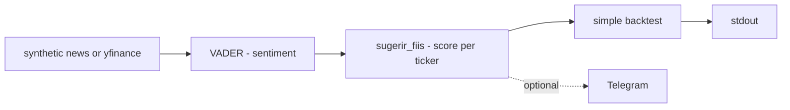

# bot-fii-sentimento

**English** · [Português (Brasil)](README.md)

[](#) [](#) [](#) [](#) [](LICENSE)

## What it is

**A Brazilian REIT (FII) sentiment bot**: it collects news (synthetic by default, or via **yfinance** with the network flag), analyses **sentiment with VADER** (NLTK), suggests FIIs by aggregated sentiment score, runs a **simple backtest** and prints the result — with optional **Telegram** delivery. It is an educational finance/NLP lab; **it is not investment advice**.

## Status

An educational lab, working and tested (13 tests). The pipeline runs offline (synthetic news, seed 42).

## Features

- **Collection** (`coleta.py`): `coletar_noticias_sinteticas(seed=42)` — offline; `coletar_via_yfinance(tickers)` when networked.
- **Sentiment** (`sentimento.py`): `analisar_sentimento(texto)` via `SentimentIntensityAnalyzer` (VADER) and `classificar(compound)` (positive/neutral/negative).
- **Suggestion** (`sugerir.py`): `sugerir_fiis(noticias, min_noticias)` — aggregated score per ticker (`Sugestao`).
- **Backtest** (`backtest.py`): `executar_backtest` — compares the picks against synthetic prices (`_gerar_precos`) and yields a `ResultadoBacktest`.
- **Notification** (`notificacao.py`): `formatar_mensagem` + `enviar_sugestoes` (Telegram, optional).
- **CLI** (`bot-fii-sentimento`): the full pipeline with flags for network/Telegram.

## Architecture

A `bot_fii_sentimento` package with independent layers (collection → sentiment → suggestion → backtest → notification), all testable offline.



## Stack

- Python ≥ 3.10
- nltk ≥ 3.8 (VADER), yfinance ≥ 0.2 (optional), telegram-lite ≥ 0.1 (optional)
- pytest (dev)

## Repository layout

```
bot-fii-sentimento/
├── pyproject.toml · BRIEF.md
├── src/bot_fii_sentimento/
│   ├── coleta.py · sentimento.py · sugerir.py
│   ├── backtest.py · notificacao.py · modelo.py
│   └── main.py · __main__.py
├── tests/           # 13 tests
└── LICENSE          # MIT
```

## Prerequisites and installation

```bash
pip install -e .
```
(First VADER run may download the NLTK lexicon.)

## How to run

```bash
bot-fii-sentimento                # offline: synthetic news
bot-fii-sentimento --usar-rede    # collects via yfinance
```
Confirm flags with `--help` (the parser is the reference).

## Tests and quality

Real command (verified by the agent):

```bash
PYTHONPATH=src python -m pytest tests/
# 13 passed
```

## Technical decisions and trade-offs

- **Lexicon-based VADER**: light and offline; it does not capture deep financial context (nor Portuguese finance-specific phrasing).
- **Synthetic news as the default**: the pipeline runs and tests without network or keys.
- **Synthetic backtest**: demonstrates the mechanics; it is no evidence of profitability.

## Known limitations and roadmap

- **This is not investment advice** — nothing here weighs risk, liquidity or asset situation.
- The backtest uses synthetic prices; results say nothing about the real market.
- Telegram requires a configured credential (optional).

## Development process

An individual project by Kelvin Oliveira, built with orchestrated AI agents and reviewed by the author.

## License and author

MIT — Copyright (c) 2026 Kelvin Rebelo de Oliveira. Author: [Kelvin Oliveira](https://github.com/KelvinOliveiraCode) · [Portfolio](https://kelvinoliveiracode.github.io/portfolio/)
