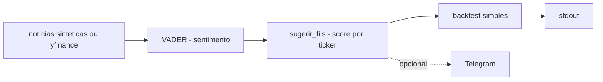

# bot-fii-sentimento

[English](README.en.md) · **Português (Brasil)**

[](#) [](#) [](#) [](#) [](LICENSE)

## O que é

**Bot de sentimento de FIIs** (fundos imobiliários): coleta notícias (sintéticas por padrão, ou **yfinance** com `--usar-rede`), analisa **sentimento com VADER** (NLTK), sugere FIIs por score agregado de sentimento, roda um **backtest simples** e imprime o resultado — com envio opcional para **Telegram**. É um laboratório educacional finanças/NLP; **não é recomendação de investimento**.

## Status

Laboratório educacional funcional e testado (13 testes). Pipeline roda offline (notícias sintéticas, seed 42).

## Funcionalidades

- **Coleta** (`coleta.py`): `coletar_noticias_sinteticas(seed=42)` — sem rede em `coletar_via_yfinance(tickers)` quando há rede.
- **Sentimento** (`sentimento.py`): `analisar_sentimento(texto)` via `SentimentIntensityAnalyzer` (VADER) e `classificar(compound)` (positivo/neutro/negativo).
- **Sugestão** (`sugerir.py`): `sugerir_fiis(noticias, min_noticias)` — score agregado por ticker (`Sugestao`).
- **Backtest** (`backtest.py`): `executar_backtest` — compara as vozes contra preços sintéticos (`_gerar_precos`) e devolve um `ResultadoBacktest`.
- **Notificação** (`notificacao.py`): `formatar_mensagem` + `enviar_sugestoes` (Telegram, opcional).
- **CLI** (`bot-fii-sentimento`): pipeline completo com flags para rede/Telegram.

## Arquitetura

Pacote `bot_fii_sentimento` com camadas independentes (coleta → sentimento → sugestão → backtest → notificação), todas testáveis offline.



## Stack

- Python ≥ 3.10
- nltk ≥ 3.8 (VADER), yfinance ≥ 0.2 (opcional), telegram-lite ≥ 0.1 (opcional)
- pytest (dev)

## Estrutura do repositório

```
bot-fii-sentimento/
├── pyproject.toml · BRIEF.md
├── src/bot_fii_sentimento/
│   ├── coleta.py · sentimento.py · sugerir.py
│   ├── backtest.py · notificacao.py · modelo.py
│   └── main.py · __main__.py
├── tests/           # 13 testes
└── LICENSE          # MIT
```

## Pré-requisitos e instalação

```bash
pip install -e .
```
(Primeira execução com VADER pode baixar o léxico do NLTK.)

## Como executar

```bash
bot-fii-sentimento                # offline: notícias sintéticas
bot-fii-sentimento --usar-rede    # coleta via yfinance
```
Confirme as flags com `--help` (o parser é a referência).

## Testes e qualificação

Comando real (verificado pelo agente):

```bash
PYTHONPATH=src python -m pytest tests/
# 13 passed
```

## Decisões técnicas e trade-offs

- **VADER léxicon-based**: leve e offline; não cobre contexto financeiro profundo (nem sarcasmo/português financeiro específico).
- **Notícias sintéticas como default**: pipeline roda e testa sem rede nem chaves.
- **Backtest sintético**: demonstra a mecânica; não é evidência de rentabilidade.

## Limitações conhecidas e roadmap

- **Não é recomendação de investimento** — nada aqui considera risco, liquidez ou situação pat passar.
- O backtest usa preços sintéticos; resultados não significam nada sobre o mercado real.
- Telegram exige credencial configurada (opcional).

## Processo de desenvolvimento

Projeto individual de Kelvin Oliveira, construído com agentes de IA orquestrados e revisado pelo autor.

## Licença e autor

MIT — Copyright (c) 2026 Kelvin Rebelo de Oliveira. Autor: [Kelvin Oliveira](https://github.com/KelvinOliveiraCode) · [Portfólio](https://kelvinoliveiracode.github.io/portfolio/)
